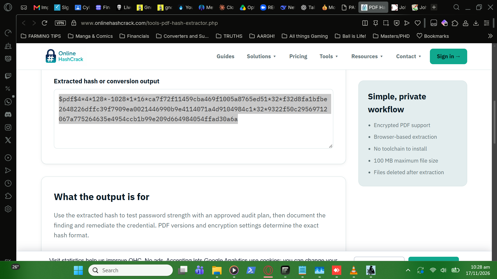
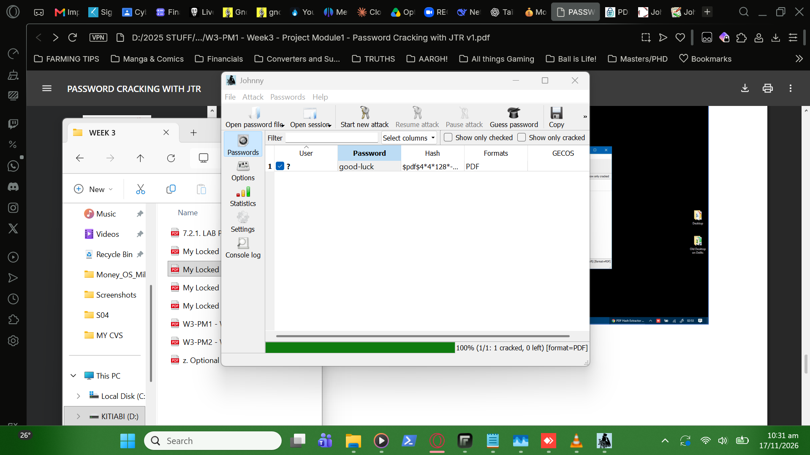
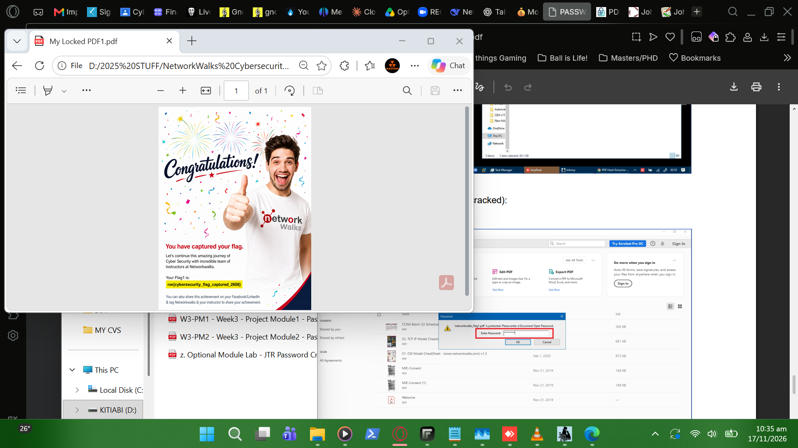

# Week 3 - Project Module 1: Password Cracking with JTR

## Overview
In this lab, I successfully cracked the password of a protected PDF file (`My Locked PDF1.pdf`) using **John the Ripper (JTR)** and its graphical interface, **Johnny**. This exercise demonstrated how offline password cracking works against encrypted files and highlighted the importance of using strong, complex passwords.

## Lab Environment
* **Operating System:** Windows PC
* **Tools Used:** John the Ripper (JTR), Johnny GUI
* **Target File:** `My Locked PDF1.pdf`
* **Hash Format:** `$pdf$` (PDF 2.0 / PDF 1.7)

## Step-by-Step Walkthrough

### Step 1: Extracting the PDF Hash
* Downloaded the locked PDF file.
* Used the **OnlineHashCrack PDF Hash Extractor** tool to extract the cryptographic hash from the file.
* Copied the extracted hash (starting with `$pdf$...`) and saved it into a text file named `hash1.txt`.

### Step 2: Configuring Johnny (JTR GUI)
* Installed Johnny and pointed the executable path to `john.exe` located inside the JTR `run` folder.
* Opened `hash1.txt` in Johnny to load the target hash.

### Step 3: Executing the Attack
* Initiated the cracking process by clicking **"Start new attack"**.
* Johnny successfully processed the hash and cracked the password.
* **Recovered Password:** `password1`

### Step 4: Capturing the Flag
* Opened `My Locked PDF1.pdf` and entered the cracked password (`password1`).
* The PDF opened successfully, revealing the Flag: 
* **Flag:** "Congratulations! You have captured your 1st flag. Let's continue this amazing journey of Cyber Security..."

## Screenshots
### 1. Hash Extraction

### 2. Johnny Attack & Cracked Password

### 3. Unlocked PDF (The Flag)

## Key Takeaways
* **The Danger of Weak Passwords:** The password `password1` was cracked almost instantly because it is a common dictionary word with a simple number appended. 
* **Offline Cracking:** Once a hash is extracted from a file, an attacker can crack it entirely offline, meaning they can take as much time as they want without triggering security alerts.
* **Defense:** Users must use long, complex passphrases. Furthermore, organizations should use strong encryption (like AES-256) and enforce strict password policies.
